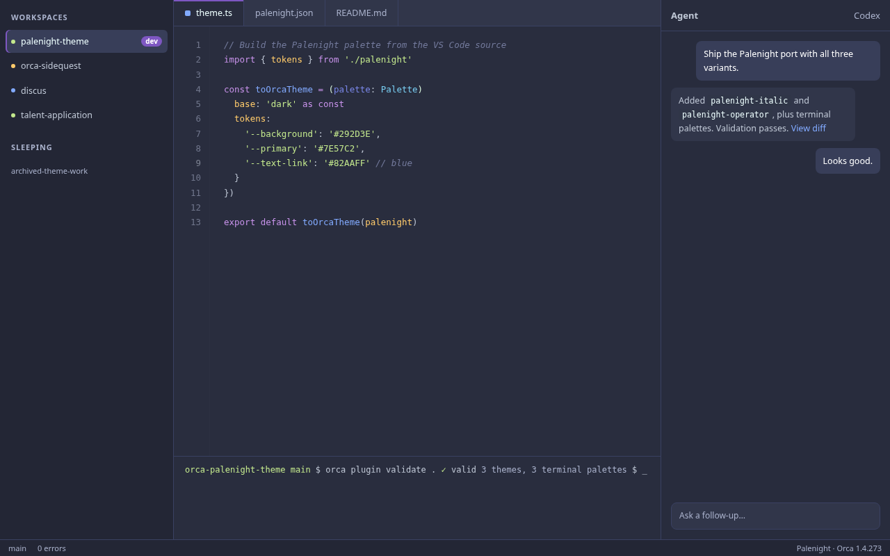

# Palenight Theme for Orca

Material Palenight for Orca. This plugin ports the four variants of [Material Palenight](https://github.com/astrit/vscode-material-palenight-theme) to Orca app themes and terminal themes, using the same palette and code colors as the VS Code theme.

## Themes

| Variant | App theme | Terminal palette |
| --- | --- | --- |
| Palenight | Palenight | Palenight |
| Palenight Italic | Palenight Italic | Palenight Italic |
| Palenight Operator | Palenight Operator | Palenight Operator |
| Palenight (Mild Contrast) | Palenight (Mild Contrast) | Palenight (Mild Contrast) |

All four use the Palenight workbench colors: #292D3E canvas, #282C3D sidebar, #232635 workspace sidebar, #7E57C2 primary, and the syntax palette of #C792EA keywords, #C3E88D strings, #FFCB6B types and #82AAFF functions. The preview above is a rendering of those tokens; pick the theme in Orca to see it on the real interface.

Palenight Italic italicises the scopes the VS Code Italic variant italicises. Palenight Operator applies the scope list from the Operator variant. Both keep the single-scope selectors Orca reads and stay inside Orca limit of 16 KiB per theme file. Palenight (Mild Contrast) keeps the editor, syntax and terminal colors of Palenight and deepens only the workbench surfaces, as the VS Code variant does.

## Install

From this folder, install the local plugin:

    orca plugin install .

The plugin is content-only, so it installs without approval. Then pick a variant under Settings > Appearance > Dark theme and the matching palette under Settings > Terminal > Dark theme.

For development, load the folder and let Orca reload it on save:

    orca plugin dev watch .

## Porting notes

- App tokens map the VS Code workbench colors onto Orca app theme tokens. Tokens Orca derives on its own (borders, hover fills) are set explicitly where the VS Code theme has an equivalent.
- tokenColors is a curated copy of the VS Code list. Orca reads the TextMate scopes it documents, so VS Code-only selectors such as descendant scopes were dropped.
- A few source colors sit below the Orca minimum of 3:1 for code colors on #292D3E: comments were lifted from #697098 to #737A9C, and the embedded-expression reds #d3423e and #ec5f67 became the nearest readable Palenight red, #FF5572.
- Text pairs were checked for 4.5:1 contrast, and --editor-selection stays translucent so find matches show through.

## License

MIT. The original theme is designed by [Olaolu Olawuyi](https://github.com/whizkydee) and released under the MIT license. This port keeps that license.

